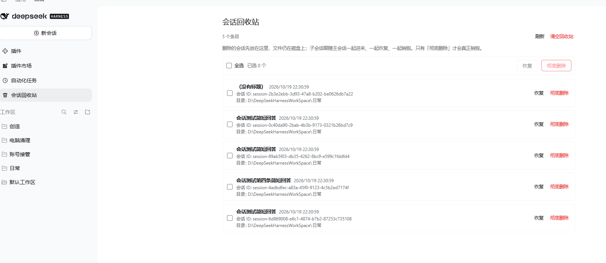
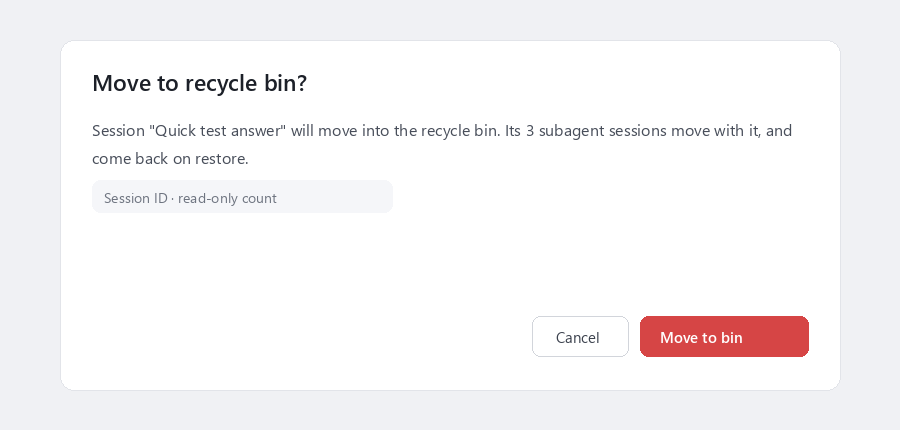
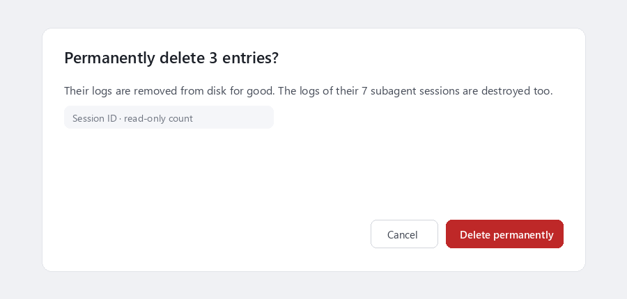

# Session Recycle Bin

**Deletes DSH sessions into a restorable recycle bin — and subagent sessions follow their parent as one tree.**

<p align="center">
  
</p>

DSH has no way to delete a session. This plugin adds one, as a two-step action: **delete moves a session into a recycle bin, where it can be restored at any time; only *purge* actually destroys bytes.**

**[中文说明 →](README.md)**

## Why this one

There are many ways to delete a session. This plugin was designed around three rules:

- **One entry = one tree.** A session's subagent sessions (the agents it delegated to) are never left behind pointing at a missing parent. Deleting a session takes its whole tree along; the bin holds one entry, and restore and purge treat the tree as a unit.
- **Nothing surprising is destroyed.** Before you confirm a delete or a purge, the dialog tells you exactly how many subagent sessions travel with it. There is no silent bulk wipe.
- **Built in.** It lives where DSH's own plugins live: a sidebar entry, the session menu, and a model tool all drive the same host methods.

## Install

The plugin is published on npm as **`dsh-recycle-bin`**.

```powershell
dsh plugin --profile <profile> add dsh-recycle-bin
```

Or simply search for **Session Recycle Bin** in the market and click install. Then **reload the DSH page** (Ctrl+F5) — the sidebar entry appears next to *Plugins*, *Schedules* and *Market*.

Local development install (the source is the running code, no build step):

```
plugin_manager { action: "install_bundle", target: "<absolute path to this directory>" }
```

## What you get

| Where | What it does |
| --- | --- |
| **Session context menu → red *Delete session…*** | Confirms first (it never deletes on a single click), and states how many subagent sessions move with it. |
| **Session context menu → *Batch actions…*** | Archive or delete every session of a workspace. Independent confirmation dialog, with the subagent count for the whole selection. |
| **Sidebar → *Session Recycle Bin*** | A full page in the main area: every bin entry with a checkbox, restore and purge on the right, and a selection bar for bulk actions. |
| **Right-click the sidebar entry** | *Clear recycle bin…* — one shortcut to purge everything, still behind the count-stating confirmation dialog. |
| **Settings → *Session Recycle Bin*** | The same bin page, for people who live in Settings. |
| **`delete_session` tool (for the model)** | `preview` / `trash` / `trashMany` / `archiveMany` / `list` / `restore` / `restoreMany` / `purge` / `purgeMany` / `purgeAll` — the same host methods the UI uses. |

<p align="center">
  
</p>

Every entry with subagent count:

<p align="center">
  
</p>

And the purge confirmation, which states how many subagent logs are destroyed:

<p align="center">
  
</p>

## How deleting works

1. **The whole tree is resolved** from the session logs on disk (by the `origin: 'subagent'` + `parentSession` recorded in each log's header), so it does not depend on what the sidebar happens to show.
2. **Admission first.** The plugin asks DSH's own archive admission whether the session has work in progress (a running turn, a background job, a live subagent, a scheduled reminder). Busy sessions are refused with `session-open`.
3. **Byte-by-byte move, then restore.** Session logs and their projection caches are *moved* into `~/.dsh/session-recycle-bin/<timestamp>-<id>/` and the session is removed from the workspace registry, so the row disappears from the sidebar.
4. **Any failure rolls back.** If any step fails, everything already moved goes back where it came from — nothing is lost.

Restoring is the reverse, and it checks *every* target path before moving a single byte: if any session of the tree would collide with an existing one, the whole restore is refused, so you never get half a tree back.

## Safety and known limits

- **Only sessions with work in progress are refused.** A session you merely opened is idle — it can be deleted, and after restoring it, the conversation continues normally.
- **Nothing is purged by accident.** Clearing the bin is not reversible: it is always behind one shared confirmation dialog, the bin page is frozen while that dialog is open, and the dialog always states the number of entries and subagent logs destroyed.
- **Never touched:** attachments (`~/.dsh/attachments/v1/objects` — content-addressed and shared across sessions), the project directories under `~/.dsh/sessions`, or any existing session with the same ID.
- **Subagent sessions cannot be deleted on their own** while the parent exists (`session-child`) — the correct action is deleting the parent. Orphaned subagent sessions (parent already gone) can still be cleaned up by ID.
- **Deleted entries keep occupying disk space** until you purge them. Nothing expires automatically.
- **Cross-volume moves on Windows** fall back from `rename` to copy (`EXDEV`); within one volume the move is an atomic rename.
- **Debugging hint:** after restoring a session, the sidebar may need one page refresh — DSH has no "session added" event to synthesize the row for a restored log.
- **Auto review permission preset** may reject the model's `delete_session` writes; that is DSH's permission policy, not the plugin. Use the UI, or another permission preset.

## Version compatibility

| Declaration | Value |
| --- | --- |
| `engines.dsh` | `0.2.0-rc.1 \|\| 0.2.0-rc.2 \|\| 0.2.1-rc.1 \|\| 0.2.1-rc.2` |
| `peerDependencies` | 10 packages: 9 `@deepseek-ai/dsh-*` with the same `0.2.x-rc.*` ranges, plus `@deepseek-ai/cordis ~4.0.5` |

**DSH 0.2 changed the plugin API** (the `settings` API was removed), so the floor is pinned at `0.2.0-rc.1` rather than a broad range that would silently exclude prerelease versions and leave users with an unexplained `ERESOLVE`.

## Uninstall

```
plugin_manager { action: "remove_bundle" }
```

Entries that are still in the bin **stay** in `~/.dsh/session-recycle-bin` after uninstalling. If the plugin is gone and you need a session back, every entry carries an `entry.json` manifest that tells you where each file belongs; move `session/` (and each `children/<id>/session/`) back to `~/.dsh/sessions/<projectDir>/<id>/` and `projcache.json` to `~/.dsh/storages/session_projcache/sessions/<id>.json`.

## License

MIT
