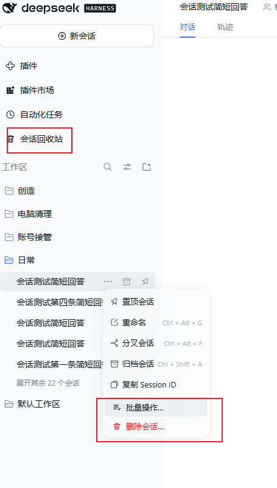
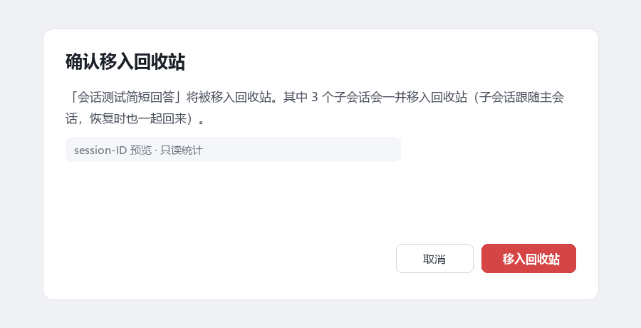
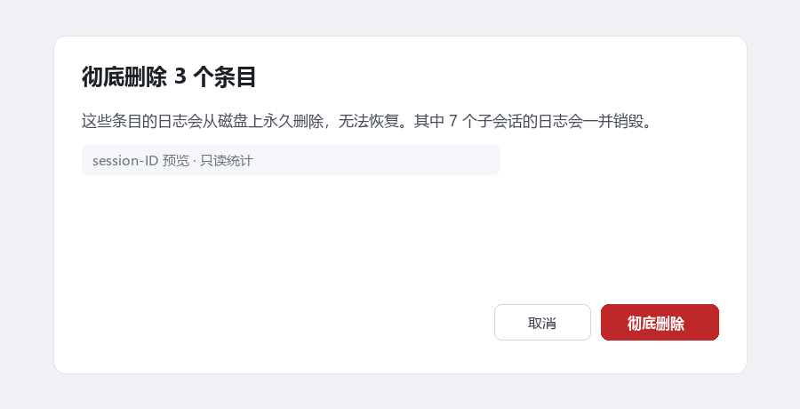

# 会话回收站 · Session Recycle Bin

**给 DSH 补上删除会话的能力——删除即移入可恢复的回收站，子会话跟随主会话整树处理。**

<p align="center">
  
</p>

DSH 没有删除会话的接口。本插件把它补上，并且做成两步：**删除 = 移入回收站**，随时可以恢复；只有「彻底删除」才真正销毁磁盘上的字节。

**[English →](README.en.md)**

## 为什么选它

能删除会话的插件不少，本插件围绕三条约定设计：

- **一条条目 = 一棵树。** 一个会话名下的子代理会话不会被落下指向一个不存在的父会话。删除一个会话会带走整棵树；回收站里它是一条条目，恢复与彻底删除都把树当成一个整体。
- **不会悄悄销毁任何东西。** 删除与销毁前，确认框都会写清楚有几个子会话会跟着走；没有静默批量清空。
- **做得正。** 侧栏入口、会话菜单、模型工具三处入口共用同一批 Host 方法，行为一致。

## 安装

插件已在 npm 发布为 **`dsh-recycle-bin`**，并已收录进 DSH 插件市场。

```powershell
dsh plugin --profile <profile> add dsh-recycle-bin
```

也可以直接在市场里搜索 **会话回收站 / Session Recycle Bin** 点安装。装完 **刷新一次页面**（Ctrl+F5），侧栏入口会出现在「插件」「定时」「市场」那一排。

本地开发安装（源码即运行代码，不需要 build）：

```
plugin_manager { action: "install_bundle", target: "<本目录绝对路径>" }
```

## 你能得到什么

| 位置 | 作用 |
| --- | --- |
| **会话右键菜单 → 红色「删除会话…」** | 先弹确认框（不会单击即删），并写明有几个子会话会一并移入 |
| **会话右键菜单 →「批量操作…」** | 对某个工作区的全部会话批量归档或删除；独立确认框，写明整个选中集合带多少子会话 |
| **侧栏「会话回收站」** | 主区打开完整页面：每条会话行首有复选框、行尾是恢复与彻底删除，上方是选择栏，可批量操作 |
| **右键侧栏图标** | 「清空回收站…」——一键清空的捷径，同样先过写明条数的确认框 |
| **设置 → 会话回收站** | 同一个回收站页，给习惯在设置里操作的人 |
| **`delete_session` 工具（给模型用）** | `preview` / `trash` / `trashMany` / `archiveMany` / `list` / `restore` / `restoreMany` / `purge` / `purgeMany` / `purgeAll`，与 UI 共用同一批 Host 方法 |

<p align="center">
  
</p>

删除确认框会写明带走的子会话数：

<p align="center">
  
</p>

彻底删除前同样先报数：

<p align="center">
  
</p>

## 一次删除做了什么

1. **先解析整棵树**：按每个会话日志 header 里的 `origin: 'subagent'` + `parentSession` 找到全部子代理会话（任意深度），不依赖侧栏当前显示什么。
2. **先过准入**：调 DSH 官方的归档准入，检查这个会话是否还有正在跑的工作（进行中的回合、后台 job、活着的子代理、定时提醒）。有工作就拒绝删除，返回 `session-open`。
3. **搬运**：会话日志与投影缓存被**移动**到 `~/.dsh/session-recycle-bin/<时间戳>-<id>/`，并从工作区登记里摘除，侧栏行随即消失。
4. **失败全部回滚**：任何一步失败，已经搬走的东西都会搬回原位，不会丢字节。

恢复是反过程，并且**先检查整棵树的所有目标路径**再动任何一个字节：只要有一个会话会与现有目录冲突，整条恢复就被拒绝，不会出现「父会话回来了、子会话还在回收站」的半棵树。

## 安全边界与已知限制

- **只有「还有工作」的会话会被拒绝删除。** 你若只是打开过会话，没有在跑的任务，它就能被删除，恢复后也能继续对话。
- **不会误销毁。** 清空回收站不可撤销，所以它总是走同一个确认对话框：对话框打开期间整个回收站页冻结，正文永远写明要销毁的条目数与子会话日志数。
- **永远不碰**：附件目录（`~/.dsh/attachments/v1/objects`，按内容寻址、跨会话共享）、`~/.dsh/sessions` 下的项目目录本身、以及任何同 ID 的既有会话。
- **父会话还在时，子会话不能被单独删除**（返回 `session-child`）——正确动作是删父会话。父会话已不存在的**孤儿子会话**仍可按 id 清理。
- **回收站条目仍占磁盘**，直到你显式彻底删除；没有自动过期清理。
- **Windows 上跨卷移动**会从 `rename` 回退到复制（`EXDEV`）；同卷内是原子 rename。
- **小提示**：恢复后侧栏可能需要刷新一次页面——DSH 没有「会话出现」事件可为恢复的日志合成行。
- **Auto review 权限预设**可能拒绝模型发起的 `delete_session` 写调用；那是 DSH 的权限策略，不是插件行为，改用 UI 或换权限预设即可。

## 版本兼容

| 声明 | 值 |
| --- | --- |
| `engines.dsh` | `0.2.0-rc.1 \|\| 0.2.0-rc.2 \|\| 0.2.1-rc.1 \|\| 0.2.1-rc.2` |
| `peerDependencies` | 10 个包：9 个 `@deepseek-ai/dsh-*`（同样的 `0.2.x-rc.*` 区间）+ `@deepseek-ai/cordis ~4.0.5` |

**DSH 0.2 与 0.1 的插件 API 不兼容**（`settings` API 在 0.2 被移除），所以下限钉在 `0.2.0-rc.1`，而不是一个会静默排除预发布版本、让用户只看到「没有解释的 `ERESOLVE`」的宽泛区间。

## 卸载

```
plugin_manager { action: "remove_bundle" }
```

**回收站里尚未恢复的条目会保留**在 `~/.dsh/session-recycle-bin`。如果插件已卸载又想把会话找回来，每个条目里都有 `entry.json` 清单写明每个文件该去哪：把 `session/`（以及每个 `children/<id>/session/`）搬回 `~/.dsh/sessions/<projectDir>/<id>/`，把 `projcache.json` 搬回 `~/.dsh/storages/session_projcache/sessions/<id>.json` 即可。

## 许可证

MIT
